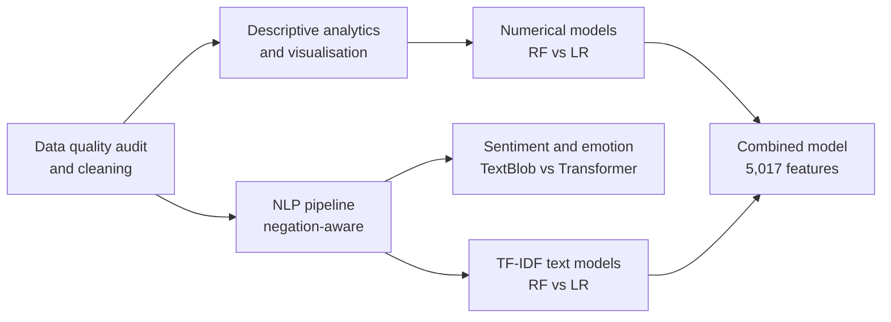
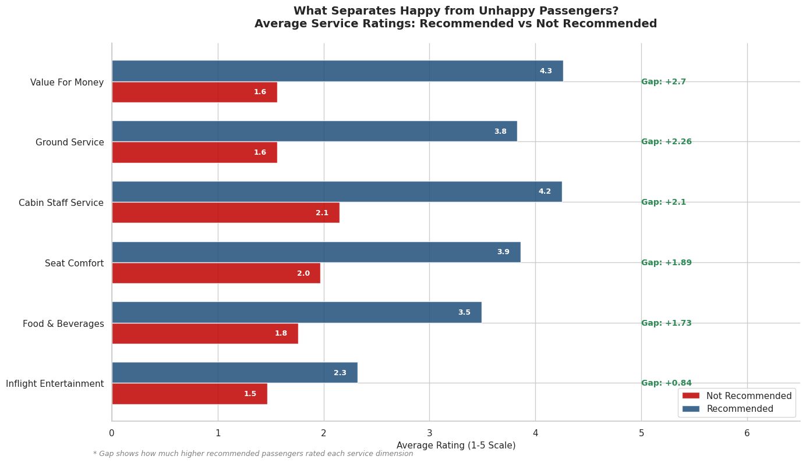
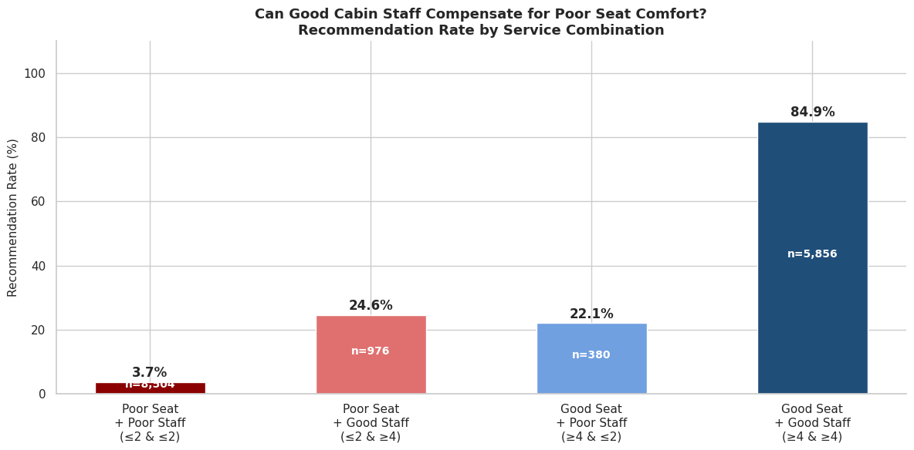
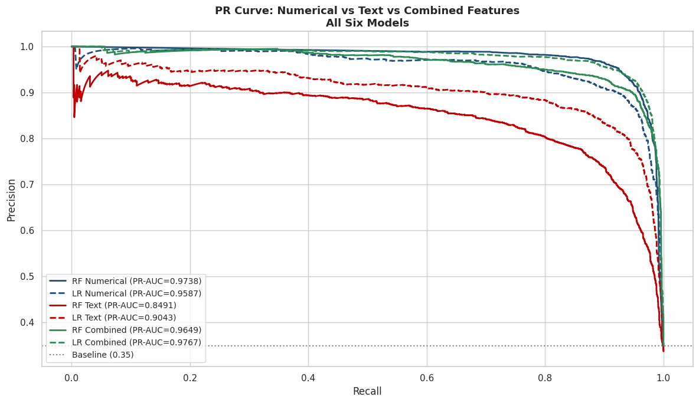
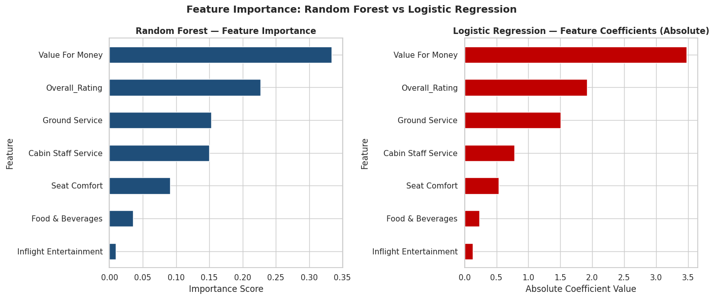
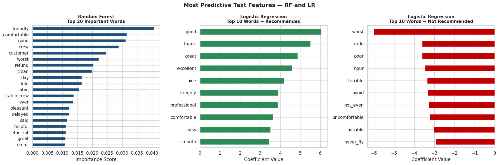
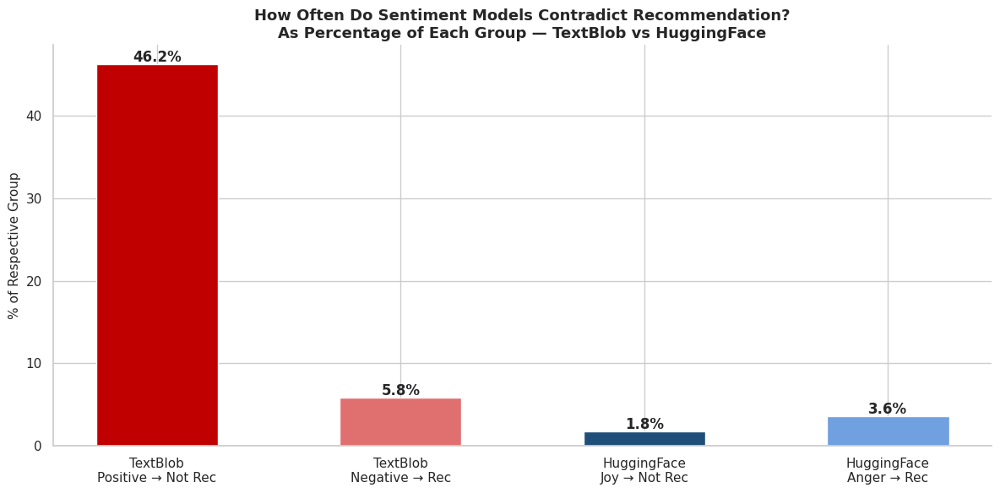
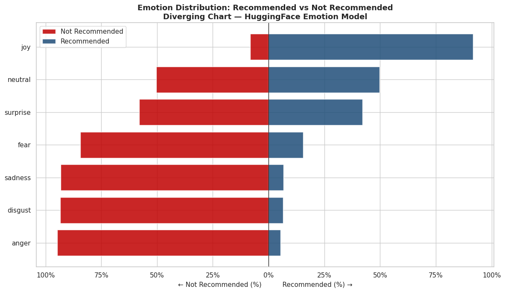
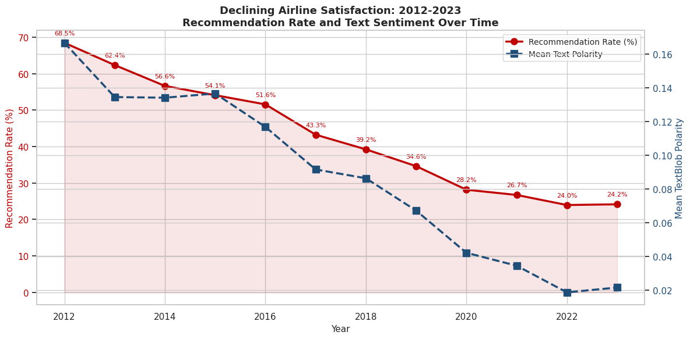

# What Makes Passengers Recommend an Airline? Ratings, Reviews and NLP

**MSc Business Analytics: Data Mining (April 2026)**
**Author:** Ria Goel  ·  **Tools:** Python (pandas, scikit-learn, NLTK, TextBlob, Hugging Face Transformers, seaborn, matplotlib) · Google Colab

> 23,171 airline reviews, 3 types of analytics, 1 question: **what drives a passenger to recommend an airline, and how much does the review text add beyond star ratings?**

---

## Key results at a glance

| | Result |
|---|---|
| **Best model** | Logistic Regression on **combined** ratings + review text: **PR-AUC 0.977**, accuracy 95.2% |
| **Best ratings-only model** | Random Forest: PR-AUC 0.974, accuracy 95.5%. It also held up on a **cross-airline stress test** (trained on 248 airlines, tested on 249 unseen ones, PR-AUC 0.983) |
| **#1 driver** | **Value for money** came out on top in four separate methods: Spearman r = 0.79, 33.4% of RF importance, the largest LR coefficient, and a jump in recommendation rate from 5.1% to 38.2% between VFM scores of 2 and 3 |
| **People matter** | Good cabin staff lift the recommendation rate from **3.7% to 24.6%** even when seat comfort is poor |
| **Sentiment tools** | The lexicon tool (TextBlob) labelled **46.5%** of dissatisfied reviews as positive. A transformer emotion model cut that to **1.9%** |
| **Trend** | Recommendation rate fell from **68.5% (2012) to 24.0% (2022)**, and the sentiment of the review text fell with it |

---

## Business problem

Airlines collect two kinds of feedback: structured service ratings and free-text reviews. Management wants to know:

1. **Which service areas** separate passengers who recommend the airline from those who don't?
2. **How accurately** can recommendation be predicted from ratings, from text, and from both together?
3. **Does review text add value** beyond the ratings, and which sentiment tools can be trusted to monitor it?

## Approach (CRISP-DM)



**Data cleaning**
- Fixed a type error: `Overall_Rating` loaded as text because of a stray `'n'` entry.
- Dropped two columns that were more than 69% missing (Wi-Fi, Aircraft).
- Filled missing service ratings with the **median for that airline**, falling back to the global median, so each carrier's own pattern was preserved. Before/after statistics confirmed this didn't distort the distributions.
- Flagged and kept **2,268 logically conflicting rows** (overall rating = 1 but "recommended") as genuine noise in the target.

**Text preprocessing.** The pipeline was designed around this dataset, where **77.1% of reviews contain negation words**:
- Contractions are expanded *before* punctuation is removed, so "didn't" survives as "did not".
- Negation joining turns phrases into single tokens, e.g. `not_good`, `never_fly`.
- Tokenised with Treebank, stopwords removed but negation words kept, then WordNet lemmatisation.

**Modelling**
- Random Forest and Logistic Regression were compared on three feature sets: 7 numerical ratings, 5,000 TF-IDF uni/bigrams, and both combined (5,017 sparse features via `scipy.sparse.hstack`).
- Used a 70/30 stratified split, `class_weight='balanced'` for the 2:1 class imbalance, 5-fold `GridSearchCV`, and decision-threshold tuning (best at 0.6). Models were evaluated on PR-AUC, ROC-AUC, precision, recall and F1.
- **Robustness test:** models were trained on one random half of the airlines and tested on the other half, to check they learn general service signals rather than airline-specific quirks.

**Sentiment analysis**
- **TextBlob** (lexicon-based) was run on all 23,171 reviews.
- **`j-hartmann/emotion-english-distilroberta-base`** (a Hugging Face transformer) was run on a stratified sample of 2,000 reviews.
- 10 ambiguous or misclassified reviews were analysed by hand to understand where each tool fails.

## Results

### What separates happy from unhappy passengers


### Good staff can partly make up for a poor seat


### Model comparison

| Model | Features | PR-AUC | Accuracy |
|---|---|---|---|
| Random Forest | Numerical | 0.9738 | 95.54% |
| Logistic Regression | Numerical | 0.9587 | 93.24% |
| Random Forest | Text | 0.8491 | 86.25% |
| Logistic Regression | Text | 0.9043 | 90.5% |
| Random Forest | Combined | 0.9649 | 94.0% |
| **Logistic Regression** | **Combined** | **0.9767** | **95.2%** |



Random Forest wins on the ratings, but Logistic Regression wins on the text. This suggests the ratings interact non-linearly, while individual words carry a more linear signal. Text-only models are well above the random baseline (0.34), so the review language carries real predictive information of its own.



### What the text reveals
- **"hour"** appears **4.9×** more often in negative reviews (10,852 vs 2,218 mentions). **Delays** are the biggest complaint, ahead of food and comfort.
- The strongest negative words in the LR model are **"worst"** (−6.0), **"rude"** (−4.5) and **"hour"** (−4.0). Negation tokens such as `not_even` and `never_fly` are also in the top 10, which supports the negation-aware pipeline.
- **"friendly"** is the single most important Random Forest text feature, scoring higher than any individual rating.



### Lexicon sentiment vs a transformer model
 

An airline relying on TextBlob alone would classify about half of its dissatisfied passengers as satisfied.

### A decade of declining satisfaction


## Recommendations for airlines
1. **Compete on perceived value.** Moving a passenger from a VFM score of 2 to 3 changes recommendation behaviour more than any other single service score.
2. **Invest in cabin staff training.** It is a cost-effective lever that partly offsets hardware weaknesses such as seat comfort.
3. **Fix ground service.** It averages below 3.0 even in Business and First Class, so the failure is systemic.
4. **Target Family Leisure travellers.** They are the least satisfied group, with weak scores for entertainment, food and seat comfort.
5. **Use transformer-based models for sentiment monitoring**, not lexicon tools.

## Limitations
- The 96% accuracy partly reflects an obvious signal: passengers who give every category 5/5 recommend 98.8% of the time.
- The recommendation trend from 2012 to 2022 means models trained on older reviews may not fully reflect today's market.
- The text pipeline can't detect sarcasm, and its fixed negation window misses negation that spans several words.
- The transformer model was run on a 2,000-review sample because of compute limits.

## Repository structure

```
├── README.md
├── notebook/
│   └── airline_reviews_analysis.ipynb   # Full analysis with all outputs (Google Colab)
├── figures/                             # Key charts from the notebook
├── reports/
│   └── Data_Mining_Report.pdf           # Full coursework report
├── data/README.md                       # Data source and how to obtain it
└── requirements.txt
```

## How to run
The notebook is shown exactly as submitted, with all outputs, so it can be read directly on GitHub without running anything.

To re-run it:
1. Open it in Google Colab.
2. Get the dataset (see [`data/README.md`](data/README.md)) and update `file_path`.
3. Run all cells. A fixed random seed is set at the start for reproducibility.

The Hugging Face emotion model runs much faster on a GPU runtime.

## Skills demonstrated
`Python` · `pandas` · `scikit-learn` · `Random Forest` · `Logistic Regression` · `hyperparameter tuning` · `imbalanced classification` · `threshold optimisation` · `NLP` · `TF-IDF` · `NLTK` · `sentiment analysis` · `Hugging Face Transformers` · `feature engineering` · `data cleaning & imputation` · `data visualisation` · `CRISP-DM` · `customer analytics`

---

*Generative AI was used as an assistant (code debugging, some plot code), as disclosed in the notebook comments and the report. The analysis, interpretation and conclusions are the author's own.*
